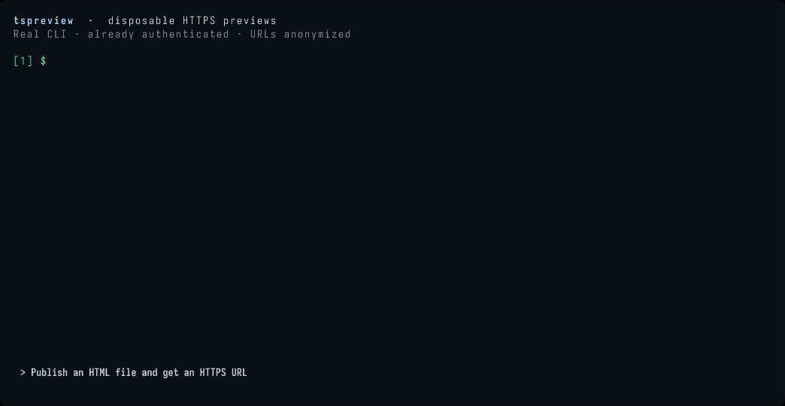

# tspreview

Share disposable HTML files and static directories over your Tailscale network.
Built for agents working on remote machines: publish a file, get an HTTPS URL,
and let it expire. Embeds its own [tsnet](https://tailscale.com/kb/1244/tsnet) node,
so no sudo, host Serve configuration, or separate Tailscale installation is needed.



Real CLI recording; URLs are anonymized and unrelated previews omitted.
[Recording details](docs/demo.md).

## Install

Requires **Linux** and **Go 1.27.3+**.

```sh
go install github.com/mholtzscher/tspreview/cmd/tspreview@latest
```

Or use [Mise](https://mise.jdx.dev/dev-tools/backends/go.html):

```sh
mise use -g go@1.27.3 go:github.com/mholtzscher/tspreview/cmd/tspreview@latest
```

Mise may defer fresh versions under its release-age policy; pin an exact Go module
version to install a newly published commit.

## Quick start

```sh
tspreview login                        # Follow the login URL once per machine/user
tspreview ./hello.html                 # Print a tailnet-only HTTPS URL
# https://tspreview-devbox.example.ts.net/p/<id>/hello.html

tspreview ./prototype/ --ttl 1h         # Include relative assets
tspreview ./prototype.html --json       # Structured output for agents
```

Login registers a separate device named `tspreview-<machine-hostname>` and saves
its identity. Enable MagicDNS and HTTPS certificates in your tailnet, approve the
device if required, and allow clients to reach it on TCP 443.

## Manage previews

```sh
tspreview list                         # List previews; start the server if stopped
tspreview rm <id>                      # Delete a preview
tspreview stop                         # Stop serving; preserve login and snapshots
```

Publishing starts one shared background server per user/state directory and
returns immediately. Multiple agents can publish concurrently. `list` and `rm`
also auto-start the server. It survives the invoking shell, but is not supervised
or started at boot. It keeps running even when all previews expire.

## Behavior and limits

- Snapshots expire after **24 hours** by default; change this with `--ttl`.
  Expired URLs return 404. Unexpired URLs survive server restarts.
- Files are copied, not watched. Publish a directory for assets; its root serves
  `index.html`. Use relative asset URLs. There are no directory listings.
- Hidden entries are skipped; explicit hidden files, symlinks, and special files
  are rejected. Each snapshot allows up to **100 MiB** and **10,000 files**.
- Successful publication prints only the URL, or JSON with `--json`. Diagnostics
  go to stderr. If the outcome is unknown, check `list --json` before retrying.

## Safety and configuration

Tailnet access rules protect the node; preview IDs are not authentication.
All previews share a browser origin. Use it for trusted prototypes, not hostile
HTML or multi-user isolation. Check published directories for secrets.

State and logs live in `$XDG_STATE_HOME/tspreview` or
`~/.local/state/tspreview`. Never publish this directory. Use `--state-dir` to
change it, `--timeout` to adjust deadlines, and `--verbose` for diagnostics.

See the [usage guide](docs/usage.md) for authentication options, logs, cleanup,
and troubleshooting. Run `tspreview --help` for command options.

## Development

```sh
go test -race ./...
go vet ./...
go build -o bin/tspreview ./cmd/tspreview
```
