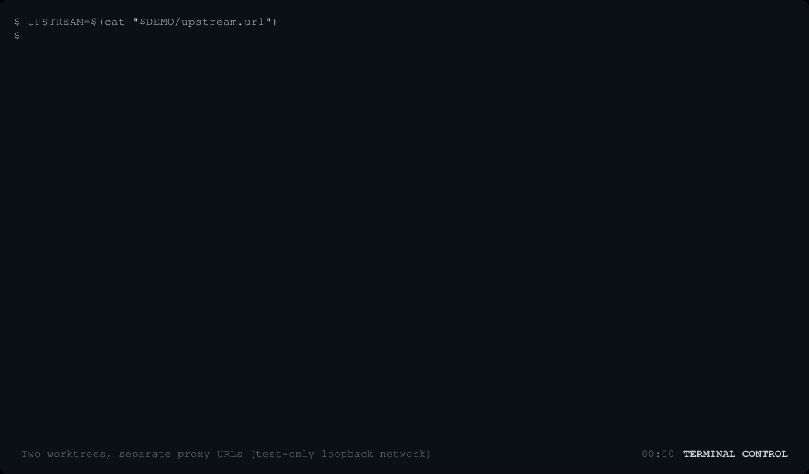
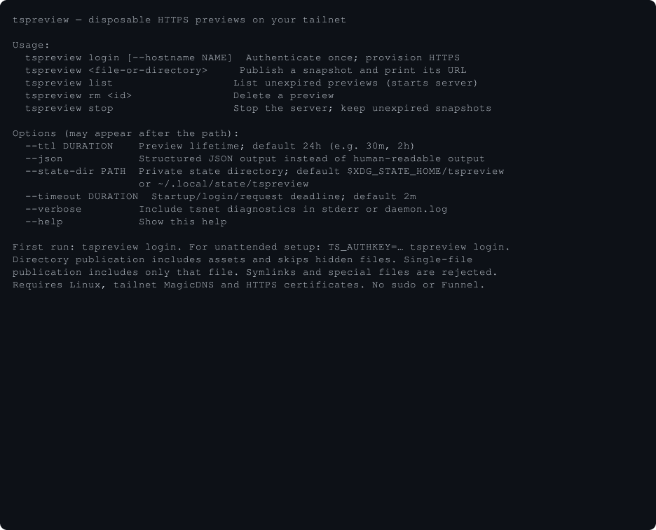
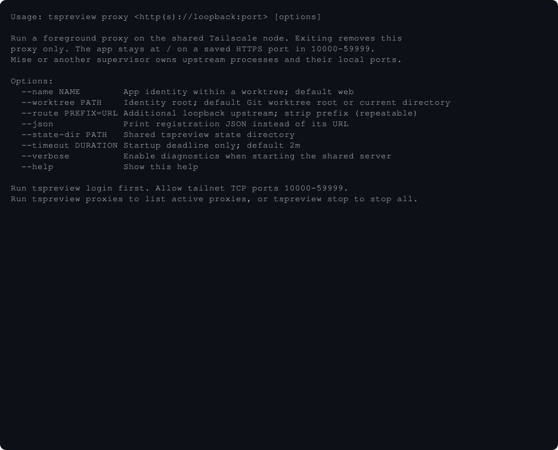

# Proxy CLI evidence

Captured from implementation revision `b80ed6c` using Terminal Control in real
PTYs. The demo uses the production CLI and daemon code with the **test-only
loopback network adapter**, plus a local Python HTTP app. It does not demonstrate
live Tailscale login, certificates, or access from another device. In production,
the URLs use HTTPS and the saved tailnet port instead of these ephemeral loopback
HTTP listeners.

The two explicit worktree directories are under
`/tmp/opencode/tspreview-proxy-demo/`. The recording starts both foreground proxy
commands as shell background jobs, lists them, fetches the real upstream through
a proxy, stops one command, and fetches the surviving proxy. The remaining proxy
and all disposable fixture processes were stopped afterward. The existing
Tailscale node, snapshots, and Hearth stack were not touched.

The terminal was 112×30 cells. Two clips were slowed and given final holds for
readability; no output or URLs were replaced. Original recording, edit plan,
MP4, and screenshots are retained under `/tmp/opencode/tspreview-proxy-demo/`.
The exported frames were decoded and inspected against both recorded states.
The recording also applies to `84a0c83`: later forwarding fixes did not change
these commands or lease-lifecycle output.

## Help before and after

`tspreview proxy --help` previously printed the general snapshot help. It now
documents the foreground proxy contract and its options. Both commands were
captured at 100×40 cells. The baseline was `440ecc3`; the after build was
`b80ed6c`.

| Before | After |
| --- | --- |
|  |  |

## Additional checks

- `go test -race ./...`, `go vet ./...`, and a production CLI build passed.
- Regression tests reproduced dropped semicolon query parameters, unavailable
  snapshots with corrupt proxy assignments, and allocation of browser-blocked
  port 10080. All passed after correction.
- A disposable real HTTP long-poll check failed after 30 seconds before the
  forwarding fix. Afterward it returned the upstream's event after 31 seconds.
  The test source and before/after logs are retained beside the recording.
- Automated tests also exercise TLS forwarding, streaming, WebSocket exchange
  and closure, concurrent registrations, restart-stable port assignments, and
  lease removal after SIGTERM or SIGKILL.

Live tailnet authentication, certificate issuance, another peer's ACL access,
and Hearth's complete browser/HMR flow were not exercised by these checks.
